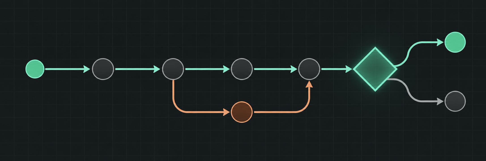
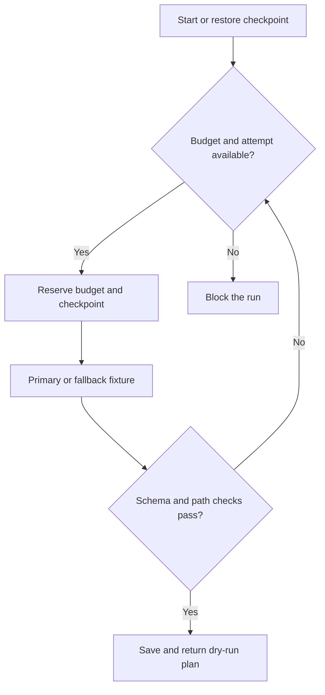

# Guardrailed Agent Workflow



**A refactor planner that can recover from malformed output without silently skipping its guardrails.** The runnable starter uses deterministic fixture responses and emits a dry-run plan.

**Python 3.10+** · **Offline** · **No API key**

[Quick start](#quick-start) · [State machine](#state-machine) · [Next milestones](#next-milestones)

## Quick start

```sh
python workflow.py --checkpoint .runs/refactor.json --pause-after-primary
python workflow.py --checkpoint .runs/refactor.json --resume
```

The primary fixture returns malformed JSON. The first command saves the rejected attempt and exits. Resume uses the fallback fixture, which produces an allowlisted plan. The successful run reserves 64 simulated tokens across two attempts.

```sh
python workflow.py --checkpoint .runs/blocked.json --budget 32
```

A 32-token reservation cap allows the primary attempt and blocks the fallback. Use a fresh path for each new run.

## State machine



| Boundary | Implemented behaviour |
| --- | --- |
| Retry | At most one fallback after the primary attempt. |
| Budget | Reserve a fixed fixture allowance before each attempt. |
| Checkpoint | Write the state via atomic file replacement for local, single-runner resume. |
| Output gate | Parse JSON and check the schema and path allowlist in a separate module. The workflow performs no repository writes. |

## Next milestones

Add a real provider adapter with timeouts and token reconciliation. Run fault injection for provider failures and interruptions, then replace the local checkpoint with a durable store before attempting concurrent workers. A repository reader and approval for any proposed edits come after the dry-run planner.

- [Workflow runner](workflow.py)
- [Output guardrails](guardrails.py)
